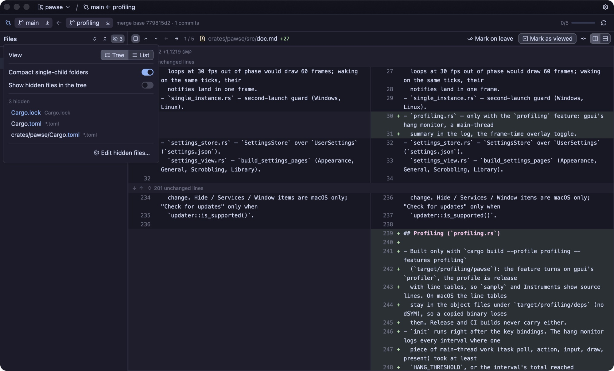

<div align="center">


# lgtm-ish

**A fast, native diff reviewer for huge merge requests, built in Rust and GPUI**: see only what a branch brings, keep track of every file you have read, and stay on the keyboard.

macOS · Windows · Linux

[Keys](#keys) · [Build from source](#building-from-source)

</div>

<table>
  <tr>
    <td width="50%"></td>
    <td width="50%"></td>
  </tr>
</table>

## Highlights

- **Only what the branch brings** — the diff from the merge base, also against the target's upstream, like GitLab: commits the target gained since never leak in.
- **Viewed progress** — mark files viewed, or let them be marked as you move on; marks roll up to folders and reset when a file changes again.
- **Review like in IntelliJ** — step through changes with `⌥↓`/`F7` straight into the next file, a movable split, a compact blame.
- **Hide the noise** — gitignore-style patterns (`*_mock.go`, `vendor/`) for one repository or all of them, added from the file tree.
- **GitLab merge requests** — open by list, URL or `!iid`, read discussions on their lines, comment, reply, resolve.
- **Your own changes** — review staged, unstaged and untracked files before you commit.

## Everything you'd expect

- Syntax highlighting for Go, Rust, TypeScript and 25+ more languages; bundled themes, separate syntax colors, Zed theme import.
- File tree or flat list, fuzzy repository and branch pickers, a whole folder of repositories added at once.
- Every shortcut rebindable, interface and code zoom, English and Russian.
- A fast-forward-only pull button for each branch. Read-only otherwise: it never edits your files.

## Keys

| Key | Action |
| --- | --- |
| `⌥↓` / `⌥↑`, `F7` / `⇧F7` | Next / previous change; past the last one, press again for the next file |
| `⌥→` / `⌥←` | Next / previous file |
| `Space` | Toggle viewed |
| `⌘B` | Show / hide the file tree |
| `⌘R` | Refresh |
| `⌘+` / `⌘−` / `⌘0` | Code text size |

All of them can be changed in Settings → Shortcuts. On Windows and Linux use `Ctrl` for `⌘`.

## Building from source

```sh
cargo run --release
```

macOS needs the Metal toolchain (`xcodebuild -downloadComponent MetalToolchain`). Debian/Ubuntu:

```sh
sudo apt-get install libfontconfig-dev libwayland-dev libxkbcommon-x11-dev build-essential cmake clang
```

Tests and lints: `cargo test --workspace`, `cargo clippy --workspace --all-targets -- -D warnings`. Releases (macOS dmg, Windows installer and portable, Linux AppImage, `.deb`, AUR) are built by `.github/workflows/release.yml`.

## License

MIT
