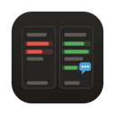
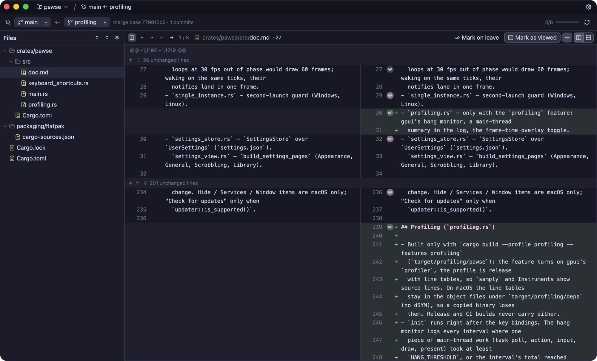

<div align="center">



# Nitpick

**A native desktop reviewer for big merge requests, built in Rust and GPUI.** Read what a branch really changes, never lose your place across hundreds of files, and talk to GitLab or GitHub without leaving the diff.

macOS · Windows · Linux

[Download](#download) · [Keys](#keys) · [Build from source](#building-from-source)

</div>



## Why

A browser tab gives up on a merge request with three hundred files: it loads slowly, forgets which files you have already read, and every new push makes you start over. Nitpick runs locally on your clone, opens any review instantly, and remembers your progress per file and per version of that file.

## What it does for you

**See only what the branch brings.** The diff is taken from the merge base, the same way GitLab shows a merge request, and also against the target's upstream. Commits the target gained since the branch was cut never leak in, so the review shows exactly the work being proposed.

**Keep your place on huge reviews.** Mark files viewed as you go, or let Nitpick mark the file you leave. A mark belongs to that exact version of the file: a new push that touches the file brings it back, and nothing else resets. Finished folders fold away. When a file you already read comes back, *since last view* shows only what changed in it since then, not the whole diff again.

**Cut the noise.** Lock files, generated code and mocks are not worth reading. Gitignore-style patterns (`package-lock.json`, `*.pb.go`, `*/mocks/*`) hide them from the tree, the progress and the navigation, for one repository or for all of them. Add one straight from the tree's context menu.

**Stay on the keyboard.** Step through changes and land in the next file automatically (`⌥↓`/`F7`, as in IntelliJ), filter files with `⌘P`, search the file with `⌘F`, toggle blame. `F4` opens the file at the current line in your editor, as a project, so its language server works — in the worktree where that branch is checked out, if there is one.

**Review without the browser.** Connect GitLab or GitHub (Enterprise and self-hosted included) and open merge requests from a list that shows authors, reviewers and comment counts, or by URL, `!123` or `#123`. Discussions appear on their lines; a separate list collects every thread on the code so none is missed. Reply, resolve, edit or delete your own comments, and approve — all from the diff.

**Check your own work first.** Review staged, unstaged and untracked changes before you commit, the same way you review someone else's.

**Fast and safe.** Native rendering stays smooth on diffs of any size. Nitpick never edits your files: the only things it does to a repository are fetches and fast-forward-only pulls you ask for.

## Everything you'd expect

- Syntax highlighting for Go, Rust, TypeScript and 25+ more languages; image previews for changed pictures.
- Side-by-side or unified diffs, whole-file view, line wrapping, ignoring whitespace.
- Bundled themes, separate syntax colors, Zed theme import; interface and code zoom.
- File tree or flat list, fuzzy repository and branch pickers, a whole folder of repositories added at once, one repository per window (native tabs on macOS).
- Every shortcut rebindable; English and Russian; automatic updates.

## Download

### macOS

**Apple Silicon (M1 and newer)** — [`arm64-dmg`](https://popovpsk.github.io/nitpick/dl/macos-arm64)

Open the dmg and move `Nitpick.app` to Applications. The app is not notarized by Apple, so macOS blocks the first launch — clear it either way:

- Launch Nitpick, then open **System Settings → Privacy & Security**, find the message about Nitpick near the bottom and click **Open Anyway**.
- Or drop the quarantine flag from a terminal and launch normally:

  ```sh
  xattr -dr com.apple.quarantine /Applications/Nitpick.app
  ```

After that it opens like any other app, and updates install themselves.

### Windows

|  | x64 *(almost every PC)* | ARM64 *(Snapdragon laptops)* |
|---|---|---|
| **Installer** *(recommended, self-updating)* | [`x64-installer`](https://popovpsk.github.io/nitpick/dl/windows-x64) | [`arm64-installer`](https://popovpsk.github.io/nitpick/dl/windows-arm64) |
| **Portable** — runs unpacked from anywhere | [`x64-portable`](https://popovpsk.github.io/nitpick/dl/windows-x64-portable) | [`arm64-portable`](https://popovpsk.github.io/nitpick/dl/windows-arm64-portable) |

The builds are not signed: in the SmartScreen dialog click *More info* → *Run anyway*. The portable zip never updates itself, so grab a new one when a release lands.

### Linux

|  | x86_64 | ARM64 |
|---|---|---|
| **AppImage** *(recommended, self-updating)* — one file, runs on any distro | [`x86_64-appimage`](https://popovpsk.github.io/nitpick/dl/linux-x86_64-appimage) | [`arm64-appimage`](https://popovpsk.github.io/nitpick/dl/linux-arm64-appimage) |
| **Debian package** — Debian, Ubuntu, Mint | [`x86_64-deb`](https://popovpsk.github.io/nitpick/dl/linux-x86_64-deb) | [`arm64-deb`](https://popovpsk.github.io/nitpick/dl/linux-arm64-deb) |

`chmod +x` the AppImage and launch it — it checks for new releases and updates itself. The `.deb` is a plain one-off package, not a repository, so grab a new one when a release lands.

All files of every release: [Releases](https://github.com/popovpsk/nitpick/releases).

## Keys

| Key | Action |
| --- | --- |
| `⌥↓` / `⌥↑`, `F7` / `⇧F7` | Next / previous change; past the last one, press again for the next file |
| `⌥→` / `⌥←` | Next / previous file |
| `Space` | Toggle viewed |
| `⌘P` | Filter files |
| `⌘F` | Find in file |
| `F4` | Open in editor at this line |
| `⌘⇧C` | Copy path |
| `⌘B` | Show / hide the file tree |
| `⌘1` / `⌘2` | Focus the tree / the diff |
| `⌘R` | Refresh |
| `⌘N` | New review |
| `⌘+` / `⌘−` / `⌘0` | Code text size |

In the tree: `j`/`k` or arrows to move, `h`/`l` to fold, `Enter` to open, `n`/`p` for the next / previous file. Every key can be changed in Settings → Shortcuts. On Windows and Linux use `Ctrl` for `⌘`.

## Building from source

```sh
cargo run --release
```

macOS needs the Metal toolchain (`xcodebuild -downloadComponent MetalToolchain`). Debian/Ubuntu:

```sh
sudo apt-get install libfontconfig-dev libwayland-dev libxkbcommon-x11-dev build-essential cmake clang
```

Tests and lints: `cargo test --workspace`, `cargo clippy --workspace --all-targets -- -D warnings`. Releases are built by `.github/workflows/release.yml`.

## License

MIT
