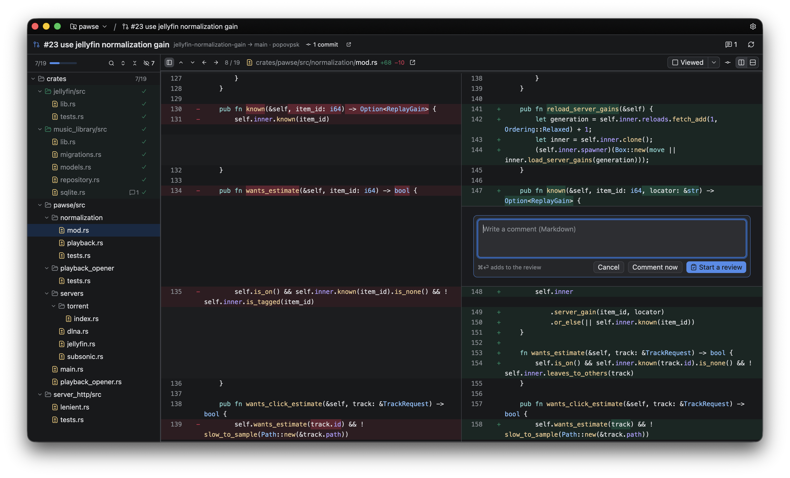

<div align="center">


# Nitpick

**A fast, native reviewer for huge merge requests, built in Rust and GPUI**: see only what a branch brings, keep track of every file you have read, and stay on the keyboard.

macOS · Windows · Linux

[Download](#download) · [Build from source](#building-from-source)

</div>



## Highlights

- **Only what the branch brings** — the diff from the merge base, like GitLab; commits the target gained since never leak in.
- **Progress that survives pushes** — viewed marks stick to the file's exact version: a new push brings back only the files it touched, and *since last view* shows just what changed since you read it.
- **Hide the noise** — gitignore-style patterns for lock files, generated code and mocks (`mocks/`), per repository or everywhere.
- **GitLab and GitHub without the browser** — open merge requests by list, URL or `!123`; read, reply, resolve, edit and approve right in the diff, with every code thread in one list.
- **An assistant that reads the change with you** — uses the agent CLI you already have installed and logged in (Claude Code, Codex, OpenCode, Pi, deepseek-harness or any ACP agent). It explains what the change does, suggests a reading order with links that jump straight to the diff line, and answers questions about the code or your selection. It runs read-only: its editing tools are turned off, and nitpick never touches your files.
- **Your own changes** — review staged, unstaged and untracked files before you commit.

## Everything you'd expect

- Syntax highlighting for 25+ languages, image previews, blame.
- Side-by-side or unified, whole-file view, line wrapping, ignore whitespace.
- Themes with separate syntax colors and Zed theme import.
- Rebindable shortcuts, English and Russian, automatic updates.
- Read-only: it never touches your files, only fetches and fast-forward pulls on request.

## Download

### macOS

**Apple Silicon (M1 and newer)** — [`arm64-dmg`](https://popovpsk.github.io/nitpick/dl/macos-arm64)

Open the dmg and move `Nitpick.app` to Applications. The app is not notarized by Apple, so macOS blocks the first launch — clear it either way:

- Launch Nitpick, then open **System Settings → Privacy & Security**, find the message about Nitpick near the bottom and click **Open Anyway**.
- Or drop the quarantine flag from a terminal and launch normally:

  ```sh
  xattr -dr com.apple.quarantine /Applications/Nitpick.app
  ```

After that it opens like any other app, and updates install themselves.

### Windows

|  | x64 *(almost every PC)* | ARM64 *(Snapdragon laptops)* |
|---|---|---|
| **Installer** *(recommended, self-updating)* | [`x64-installer`](https://popovpsk.github.io/nitpick/dl/windows-x64) | [`arm64-installer`](https://popovpsk.github.io/nitpick/dl/windows-arm64) |
| **Portable** — runs unpacked from anywhere | [`x64-portable`](https://popovpsk.github.io/nitpick/dl/windows-x64-portable) | [`arm64-portable`](https://popovpsk.github.io/nitpick/dl/windows-arm64-portable) |

The builds are not signed: in the SmartScreen dialog click *More info* → *Run anyway*. The portable zip never updates itself, so grab a new one when a release lands.

### Linux

|  | x86_64 | ARM64 |
|---|---|---|
| **AppImage** *(recommended, self-updating)* — one file, runs on any distro | [`x86_64-appimage`](https://popovpsk.github.io/nitpick/dl/linux-x86_64-appimage) | [`arm64-appimage`](https://popovpsk.github.io/nitpick/dl/linux-arm64-appimage) |
| **Debian package** — Debian, Ubuntu, Mint | [`x86_64-deb`](https://popovpsk.github.io/nitpick/dl/linux-x86_64-deb) | [`arm64-deb`](https://popovpsk.github.io/nitpick/dl/linux-arm64-deb) |

`chmod +x` the AppImage and launch it — it checks for new releases and updates itself. The `.deb` is a plain one-off package, not a repository, so grab a new one when a release lands.

All files of every release: [Releases](https://github.com/popovpsk/nitpick/releases).

## Building from source

```sh
cargo run --release
```

macOS needs the Metal toolchain (`xcodebuild -downloadComponent MetalToolchain`). Debian/Ubuntu:

```sh
sudo apt-get install libfontconfig-dev libwayland-dev libxkbcommon-x11-dev build-essential cmake clang
```

Tests and lints: `cargo test --workspace`, `cargo clippy --workspace --all-targets -- -D warnings`. Releases are built by `.github/workflows/release.yml`.

## License

MIT
